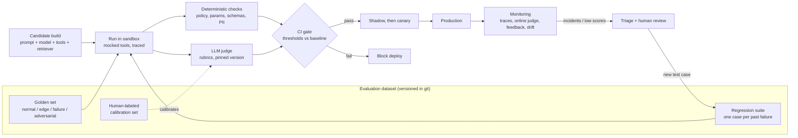

# Design Review: Evaluation Strategy for the Enterprise Operations Assistant

**Audience:** Engineering, Model Risk, and Compliance · **Status:** Proposed for approval · **Scope:** Pre-deployment evaluation, release gating, and production monitoring

**Summary.** The assistant answers questions from enterprise knowledge, calls tools, and runs workflow automation for internal staff at a regulated firm. This review proposes one evaluation system that serves three purposes: it decides whether a build can ship, it stops known failures from coming back, and it detects new failures in production. Rules that compliance depends on are enforced by **deterministic checks** (pass/fail code), never by an LLM's judgment. LLM judges are used only for qualities that code cannot measure, and only after calibration against human reviewers.

## 1. Evaluation objectives

Success means the assistant completes employee tasks correctly, never takes an unauthorized or unverified action, and leaves a full audit trail. Each objective has a metric and a release threshold.

| Objective | Metric | Threshold |
|---|---|---|
| Task success | % of golden-set tasks completed correctly end to end | ≥ 90% overall, ≥ 95% on high-risk workflows |
| Grounded answers | Faithfulness: share of claims supported by retrieved sources | ≥ 0.95; citation accuracy ≥ 98% |
| Correct tool use | Right tool + exactly correct parameters | ≥ 98%; 100% on amounts, account IDs |
| Control compliance | Verification/approval before every state-changing action | **100%** (hard gate) |
| Data protection | PII or cross-entitlement data leakage | **0 cases** (hard gate) |
| Safe refusal/escalation | Correctly refuses or hands to a human when out of policy | ≥ 95% recall on must-escalate cases |
| Operability | p95 latency; cost per task | ≤ 8 s per turn; within budget ±10% of baseline |
| Auditability | Traces with complete inputs, tool calls, sources, versions | 100% |

## 2. Evaluation levels

All three levels are needed because a correct final answer can hide a dangerous path, and a good path can still fail because one component is weak.

- **End to end.** Score the final outcome of a full task: was the answer correct, grounded, and compliant? This is what the business experiences, but on its own it cannot say *why* something failed.
- **Agent trajectory.** Score the sequence of steps: which tools were called, in what order, with which arguments, and how many steps it took. This catches an agent that reaches the right answer by skipping a verification step, which is unacceptable in a regulated setting even when the outcome looks fine.
- **Components.** Test each part in isolation so failures can be localized:
  - *Retriever:* context recall and precision, recall@k and MRR against labeled relevant documents; entitlement filtering (users only retrieve what they may see).
  - *Tools:* schema validation, error handling, idempotency, using recorded fixtures.
  - *Guardrails:* precision and recall on labeled harmful/benign inputs (blocking good requests is also a failure).
  - *Memory:* correct recall within a session; no leakage of one user's data into another session.

## 3. Dataset design

**Sources.** (a) Real, anonymized employee requests from the pilot, labeled by subject-matter experts; (b) workflow scenarios written from operating procedures; (c) synthetic variants generated by an LLM and **always reviewed by a human** before inclusion; (d) red-team cases.

**Deliberate mix** (target for the ~1,500-case golden set, stratified by workflow and risk tier):

| Case type | Share | Examples |
|---|---|---|
| Normal | ~50% | Policy lookup, account status, standard workflow request |
| Edge | ~20% | Ambiguous requests, conflicting documents, missing fields, multi-turn changes of mind |
| Failure | ~15% | Tool timeouts, empty retrieval, stale data, a downstream system returning an error |
| Adversarial | ~15% | Prompt injection in user input **and in retrieved documents**, social engineering to skip verification, attempts to access another team's data |

Each case stores: input, conversation context, mocked tool responses, expected outcome, expected or forbidden tool calls, risk tier, source, and owner. A separate **held-out set** is never used for prompt tuning, so scores are not inflated by optimizing against the test.

**Growth.** The dataset grows from three feeds: production failures (see Section 6), monthly sampling of new production traffic to track how real usage is shifting, and a quarterly red-team exercise. Coverage is reviewed each quarter against the workflow inventory, so no workflow is shipped without cases.

## 4. Tool evaluation strategy

Tools run against a **sandbox with recorded fixtures**, so tests are repeatable and nothing touches real systems. Every run produces a trace, and the trace is checked by code ("policy-as-code") that returns pass or fail:

- **Verification before action:** no state-changing tool (e.g., `update_account`, `submit_payment_request`) may appear before a successful `verify_identity` / approval step in the same trace.
- **Parameter correctness:** amounts, account IDs, and dates must exactly match the expected values; other fields are validated against the tool's JSON schema.
- **Forbidden actions:** tools outside the user's entitlements are never called; no tool is called twice in a way that would duplicate a transaction.
- **Error handling:** after a tool failure, the agent must retry within limits or escalate. It must never claim success.
- **Efficiency:** step count and redundant calls are tracked against a budget.

These checks run on **100% of test cases and 100% of production traces**. Any violation of a control rule fails the build regardless of every other score.

## 5. LLM-as-judge framework

**Rubrics.** Separate judges score one dimension each: correctness, groundedness, completeness, policy adherence, and clarity. Each uses a 1–4 scale where every level has a written definition and an example. Where possible, a dimension is broken into a **checklist** of yes/no questions (e.g., "Does the answer cite the policy section it relies on?"), which is more reliable than a single overall score.

**Approach.**
- *Pointwise* scoring for release gates, because gates need an absolute score.
- *Pairwise* comparison when choosing between two candidates (a new prompt, a new model).
- *Checklist* scoring for compliance-related wording, used to add evidence on top of the deterministic checks, never to replace them.

**Calibration.** At least two subject-matter experts label a 300-case calibration set. Human-to-human agreement is measured first, because that sets the ceiling. A judge is approved only if its agreement with the human consensus (Cohen's κ, or Spearman correlation for scales) is ≥ 0.7 and close to the human-to-human level. Calibration is repeated quarterly and whenever the judge model or a rubric changes.

**Known risks and controls.**
- *Scale drift* (scores creep over time with no real change): pin the judge model version and prompt; re-score a fixed set of anchor cases every run and alert if their scores move.
- *Position bias* in pairwise judging: run each comparison in both orders and count only consistent verdicts; inconsistent pairs go to a human.
- *Verbosity bias:* rubrics state that length is not a quality; scores are checked for correlation with response length.
- *Self-preference:* the judge comes from a different model family than the assistant where possible.

## 6. Regression testing strategy

**Failure to test.** Every production incident, escalated complaint, or low-scoring trace is triaged within five business days. If it reflects a real defect, an engineer reduces it to the smallest input that reproduces it, adds the expected behavior and a deterministic assertion where possible, and commits it to the regression suite with a link to the incident. The fix is not considered complete until that test passes.

**Maintenance.** The suite lives in git next to prompts and configs, with a version number that is recorded on every evaluation run, so any past result can be reproduced. Each test has an owner, severity, and origin. Because model outputs vary, each case runs several times; high-risk cases must pass **every** run (pass^k), not just on average. Tests are retired only through review, and tests that came from compliance incidents need Compliance sign-off to remove. Flaky tests are fixed or quarantined with a deadline, never silently ignored.

## 7. CI/CD integration

| Stage | What runs | Time |
|---|---|---|
| Pull request | Component tests, deterministic checks, smoke subset of regression suite | ~10 min |
| Merge to main | Full regression suite + golden set + LLM judges | ~1 hr |
| Release candidate | Everything above + held-out set + adversarial suite + human spot review of a sample | Hours |
| Shadow | New build runs on live traffic; responses logged, not shown | 1 week |
| Canary | 5% of users, automatic rollback if online metrics drop | 1 week |

**Gates that block a deploy:**
- **Hard gates (any failure blocks):** control-compliance violations, PII leakage, any failed high-severity regression test.
- **Threshold gates:** task success, tool accuracy, and faithfulness at or above the Section 1 thresholds.
- **Non-regression gates:** no metric worse than the current production baseline beyond its measured noise (compared with confidence intervals, not a single number).
- **Budget gates:** p95 latency ≤ 8 s and cost per task within +10% of baseline.

Gate results and the dataset, model, and prompt versions are stored as release evidence for audit.

## 8. Monitoring and continuous evaluation

- **Tracing:** every request is traced end to end (inputs, retrieved documents, tool calls, outputs, versions) using OpenTelemetry, kept per the firm's retention policy.
- **Online evaluation:** deterministic policy checks run on all traffic; LLM judges score a 2–5% sample, with heavier sampling on high-risk workflows.
- **User feedback:** thumbs up/down, free-text comments, and human escalations are tracked by workflow; negative signals feed the triage queue.
- **Drift detection:** watch the mix of request types, embedding-based input distribution (e.g., population stability index), retrieval hit rate, refusal rate, and tool error rate. Alerts trigger an investigation and a refresh of the evaluation dataset.
- **Model upgrades:** a new model version is treated as a new release. It runs the full offline suite, a pairwise comparison against the current model, replay of recent production traffic, then shadow and canary. It is recorded in the model inventory, consistent with model risk management guidance such as SR 11-7.

## 9. Risk assessment

| Blind spot | Why it matters | Mitigation |
|---|---|---|
| Distribution shift | Real usage moves away from the test set; scores look good while production degrades | Drift alerts; monthly sampling of production traffic into the dataset |
| Judge bias or drift | A miscalibrated judge passes bad outputs | Quarterly calibration, anchor cases, pinned versions; compliance rules never rely on the judge |
| Unanticipated attacks | New injection or social-engineering patterns, especially via retrieved documents | Quarterly red-teaming, coverage mapped to the OWASP Top 10 for LLM Applications, runtime guardrails, least-privilege tool access |
| Overfitting to the eval set | Prompts tuned until tests pass without real improvement | Held-out set, rotation of new cases, human spot review |
| Mock vs. reality gap | Sandbox fixtures differ from real systems | Contract tests against real tool schemas; shadow mode on live traffic |
| Random variation | One passing run hides an intermittent failure | Multiple runs per case, pass^k on high-risk cases |
| Label errors | Wrong "expected" answers mislead every metric | Two-reviewer labeling, disagreement review, periodic audit |
| Regulatory exposure | Unverified actions, data leakage, or missing audit trails create compliance findings | Hard gates at 100%, full tracing, stored release evidence, Compliance sign-off on high-risk changes |

**Decision requested:** approve this strategy as the release criteria for production, with Compliance as co-owner of the hard gates and of the regression suite's compliance cases.
